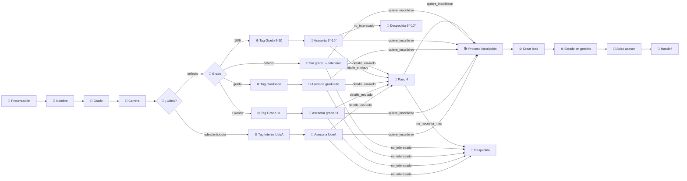
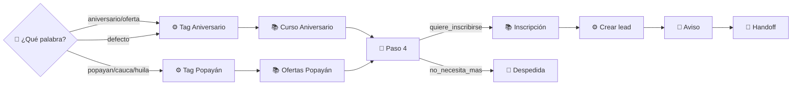
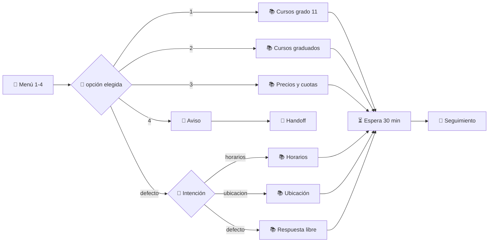

# Contenido de prueba — Pre-ICFES Estudiando

> Inquilino: **PreICFES Estudiando** · Usuario: `user1-preicfes@estudiando.co` (rol admin)
> Basado en `EJEMPLOS SOFIAPP.docx`. **Todos los datos (precios, direcciones, teléfonos, puntajes) son
> ficticios**, creados para probar el chat de HU-IA-08.
> Fecha de redacción: 2026-11-04 · Ciclo de cursos simulado: **2027-1**.

---

## 0. Mapa de carga (orden recomendado)

| # | Qué cargar | Dónde (ruta en SofiApp) | Límites que respeta este documento |
|---|---|---|---|
| 1 | Etiquetas | **Etiquetas** · `/etiquetas` | nombre ≤ 30 car. |
| 2 | Base de conocimiento: 5 categorías fijas | **Base de conocimiento** · `/settings/knowledge` | catálogo ≤ 12 filas (nombre ≤ 120, descripción ≤ 240); resumen ≤ 900; texto largo ≤ 1.500; documento ≤ 15.000 |
| 3 | Base de conocimiento: 4 documentos adicionales | `/settings/knowledge` → *Nuevo documento* | título ≤ 400, contenido ≤ 15.000 |
| 4 | Preguntas frecuentes | `/settings/knowledge/faqs` | pregunta 3–700, respuesta ≤ 2.000 |
| 5 | Comportamiento del asistente (tono + prompt) | **Comportamiento** · `/settings/assistant` | tono ≤ 200, prompt ≤ 8.000 |
| 6 | Reglas de transferencia a asesor | `/settings/assistant/handoff` | frases/palabras 2–80 car., máx. 30 |
| 7 | Flujos (en **borrador**, sin activar) | **Flujos** · `/flows` | ver `00-flows-documentation.md` |
| 8 | Probar | **Probar asistente** · `/settings/assistant/test` | elegir el flujo en la sesión |

> **Carga automática** (alternativa a la carga manual):
> 1. `01-mongosh-carga-preicfes.js` (mongosh): etiquetas, prompt + tono, reglas de transferencia y los 3 flujos (filas 1, 5, 6 y 7).
>    `mongosh "<MONGODB_URI>" --file .test-chat/01-mongosh-carga-preicfes.js`. Primero con `DRY_RUN = true`.
> 2. `02-navegador-kb-faqs.js` (consola del navegador con tu sesión): base de conocimiento y FAQs (filas 2, 3 y 4).
>    Van por el API porque necesitan embeddings e indexación, que mongosh no puede generar.

> "**Mi Comercio**" del documento de ejemplos = categoría **Productos y servicios** de la base de conocimiento.
> "**Guía de conocimiento**" = resto de la base de conocimiento + FAQs.

---

## 1. Etiquetas (`/etiquetas`)

Se usan en los nodos `accion` de los flujos para segmentar a los clientes.

| Nombre | Color sugerido |
|---|---|
| Grado 11 | `#2563EB` |
| Graduado | `#7C3AED` |
| Grado 9-10 | `#0891B2` |
| Interés UdeA | `#16A34A` |
| Aniversario | `#EA580C` |
| Popayán | `#DB2777` |
| Pide cuotas | `#CA8A04` |

---

## 2. Base de conocimiento — categorías fijas (`/settings/knowledge`)

### 2.1 Información de la empresa *(obligatoria)*

| Campo del formulario | Valor |
|---|---|
| Nombre comercial | Pre-ICFES Estudiando |
| Razón social | Instituto Estudiando S.A.S. |
| ¿A qué se dedica? | Instituto de preparación académica para la Prueba Saber 11 (ICFES) y exámenes de admisión universitaria. Acompañamos a estudiantes de grados 9°, 10°, 11° y graduados con cursos presenciales y virtuales, simulacros tipo ICFES y orientación profesional para que ingresen a la carrera y universidad que sueñan. |
| Año de fundación | 2011 |
| Misión | Preparar a cada estudiante para alcanzar el puntaje que necesita en la Prueba Saber 11 y en los exámenes de admisión, mediante una metodología de práctica intensiva, docentes expertos y seguimiento personalizado, para que dé el paso a la universidad con seguridad. |
| Visión | Ser en 2030 el instituto Pre-ICFES de referencia del suroccidente colombiano, reconocido por los resultados medibles de sus estudiantes y por llevar la preparación de calidad a más municipios de Nariño, Cauca y Huila. |
| Valores (≤6) | Compromiso · Disciplina · Excelencia académica · Cercanía · Honestidad · Superación |
| ¿A quién le sirve? | Estudiantes de grado 11 (jornada mañana o tarde), estudiantes de 9° y 10° que quieren adelantarse, bachilleres graduados que buscan mejorar su puntaje y aspirantes a la Universidad de Antioquia (UdeA). También padres de familia que buscan asesoría. |
| Zonas donde atiende (≤12) | Pasto · Ipiales · Tumaco · Túquerres · Popayán · Santander de Quilichao · Neiva · Pitalito · Nariño · Cauca · Huila · Virtual en toda Colombia |
| Qué lo hace distinto (≤6) | Garantía de puntaje en el curso intensivo · Simulacros tipo ICFES cada 2 semanas · Taller de orientación profesional incluido · Horarios en contrajornada para colegios de mañana y de tarde · Docentes especialistas por área · Seguimiento académico con reportes a padres |
| ¿Hace parte de un grupo? | No |
| Certificaciones (≤6) | Licencia de funcionamiento de la Secretaría de Educación Municipal de Pasto · Registro de programas de educación para el trabajo y el desarrollo humano |

### 2.2 Productos y servicios *(obligatoria — "Mi Comercio")*

**¿Qué vende o qué servicios presta?** *(resumen ≤ 900)*
> Cursos de preparación para la Prueba Saber 11 (ICFES) y para el examen de admisión de la Universidad de Antioquia. Ofrecemos: curso intensivo con garantía (doble jornada), cursos semi-intensivos en contrajornada (jornada tarde para estudiantes de colegios de la mañana y jornada mañana para colegios de la tarde), curso sabatino, curso Saber 11 para grados 9° y 10°, Pre-U UdeA presencial y virtual, cursos por áreas y el curso especial de Aniversario. En la sede Popayán hay cursos en oferta con 50% y 20% de descuento. Todos incluyen material exclusivo, simulacros tipo ICFES y taller de orientación profesional. Inscripción: $100.000 para separar el cupo.

**Productos y servicios** *(catálogo: 12 filas, descripción ≤ 240)*

| # | Nombre | Qué es o qué incluye |
|---|---|---|
| 1 | Pre-ICFES Intensivo con Garantía | Doble jornada L-V 8:00-12:00 y 2:00-6:00 p.m. Inicia 12 ene 2027 hasta el ICFES. Si no alcanza el puntaje de su carrera repite gratis. Para graduados o grado 11 con tiempo completo. $4.200.000 |
| 2 | Semi-intensivo Jornada Tarde | Para estudiantes de colegios de jornada mañana. L-V 2:30-5:30 p.m. Inicia 1 feb 2027, 5 meses. Clases, talleres y simulacros quincenales. $2.400.000 |
| 3 | Semi-intensivo Jornada Mañana | Para estudiantes de colegios de jornada tarde. L-V 7:00-10:00 a.m. Inicia 1 feb 2027, 5 meses. Clases, talleres y simulacros quincenales. $2.400.000 |
| 4 | Curso Sabatino | Sábados 8:00 a.m.-1:00 p.m. Inicia 6 feb 2027, 6 meses. Ideal para quien estudia o trabaja entre semana. Todas las áreas del ICFES y simulacros mensuales. $1.800.000 |
| 5 | Saber 11 Grados 9° y 10° | Bases de matemáticas, lectura crítica, ciencias, sociales e inglés para llegar fuertes a grado 11. Sábados 2:00-5:00 p.m. Inicia 6 feb 2027, 4 meses. $1.200.000 |
| 6 | Pre-U UdeA Presencial | Preparación para el examen de admisión de la Universidad de Antioquia (razonamiento lógico y competencia lectora). L-V 3:00-6:00 p.m., 3 meses. $2.100.000 |
| 7 | Pre-U UdeA Virtual | Clases en vivo L-Mi-V 6:30-9:00 p.m. + plataforma con grabaciones y simulacros tipo UdeA. 3 meses, desde cualquier ciudad. $1.500.000 |
| 8 | Curso por Áreas | Refuerzo de un área: matemáticas, lectura crítica, ciencias naturales, sociales o inglés. Martes y jueves 5:00-7:00 p.m., 2 meses. $650.000 por área |
| 9 | Curso de Aniversario (oferta) | Edición especial por nuestros 15 años. Intensivo de 3 meses L-V 2:00-6:00 p.m., inicia 18 ene 2027. Precio especial $2.900.000 (antes $4.200.000). Solo 30 cupos. |
| 10 | Popayán: Semi-intensivo 50% dcto | Solo sede Popayán. L-V 2:30-5:30 p.m., inicia 1 feb 2027, 5 meses. Precio con 50% de descuento: $1.200.000 (antes $2.400.000). Cupos limitados. |
| 11 | Popayán: Sabatino 20% dcto | Solo sede Popayán. Sábados 8:00 a.m.-1:00 p.m., inicia 6 feb 2027, 6 meses. Precio con 20% de descuento: $1.440.000 (antes $1.800.000). |
| 12 | Taller de Orientación Profesional | Taller de 4 sesiones con psicóloga para elegir carrera: test vocacional, perfiles profesionales y universidades. Incluido gratis en todos los cursos de grado 11 y graduados. |

**Cómo se cotiza** *(notas de precios)*
> Los precios son por curso completo e incluyen material, simulacros y taller de orientación. La inscripción ($100.000) se paga aparte para separar el cupo y se descuenta del valor total. Los descuentos no son acumulables.

**Formas de pago** *(≤8, ≤120 c/u)*
- Pago de contado con 5% de descuento
- Pago a cuotas mensuales sin intereses
- Transferencia Bancolombia o Nequi
- Tarjeta débito o crédito en sede
- Efectivo en sede

**Promociones o descuentos**
> Curso de Aniversario a $2.900.000 (30 cupos). Sede Popayán: 50% en semi-intensivo y 20% en sabatino. 10% de descuento por hermanos o por referir a un amigo que se inscriba.

**Cómo se entrega** *(≤6)*
- Presencial en sede Pasto
- Presencial en sede Popayán
- Virtual con clases en vivo

**Tiempos de entrega**
> Cada curso tiene fecha de inicio fija (ver catálogo). Las clases virtuales quedan grabadas por 30 días en la plataforma.

### 2.3 Horarios y ubicación

| Campo | Valor |
|---|---|
| Dirección | Sede principal Pasto: Calle 18 # 25-40, Centro, Pasto, Nariño (segundo piso, Edificio Galerías) |
| Cómo llegar | A media cuadra de la Plaza de Nariño. Rutas urbanas C1, C4 y E8 paran en la Calle 18. Parqueadero público en la Carrera 25. |
| Otras sedes | **Sede Popayán** · Carrera 6 # 4-21, Centro Histórico, Popayán, Cauca · (602) 820 0000 |
| WhatsApp | +57 300 000 0000 |
| Teléfono | (602) 730 0000 |
| Correo electrónico | info@preicfesestudiando.test |
| Redes sociales | Instagram @preicfesestudiando · Facebook /preicfesestudiando · TikTok @preicfesestudiando |
| Horario de atención | Lunes a viernes 7:00 a.m.–7:00 p.m. · Sábado 8:00 a.m.–2:00 p.m. · Domingo **Cerrado** |
| Días especiales | Festivos cerrado. En Semana Santa y del 20 dic al 6 ene solo atendemos por WhatsApp. |

### 2.4 Políticas y términos

| Pregunta | Respuesta | Detalle |
|---|---|---|
| ¿Aceptan devoluciones? | Sí | Hasta 8 días antes del inicio del curso se devuelve el 100% de lo pagado, excepto la inscripción. Iniciado el curso no hay devolución, pero se puede congelar el cupo una vez por calamidad. |
| ¿Hacen cambios? | Sí | Se puede cambiar de curso o jornada dentro de las primeras 2 semanas, pagando la diferencia si el nuevo curso es más costoso. |
| ¿Ofrecen garantía? | Sí | Solo el Intensivo con Garantía: si el estudiante no alcanza el puntaje de su carrera, repite el curso sin costo, con asistencia mínima del 90% y todos los simulacros presentados. |
| ¿Se atiende con reserva o cita previa? | No | — |
| ¿Admiten mascotas? | No | — |
| ¿Hay consumo o pedido mínimo? | No | — |

**Otras políticas** *(≤800)*
> La inscripción de $100.000 no es reembolsable. Edad mínima: estudiantes desde grado 9°. Los menores de edad se inscriben con un acudiente. Las clases perdidas pueden recuperarse con la grabación (virtual) o en otro grupo de la misma jornada (presencial), con aviso previo. Tratamiento de datos según la Ley 1581 de 2012.

**Términos y condiciones**
> El cupo se garantiza con el pago de la inscripción. Las cuotas deben pagarse en las fechas acordadas; con más de 15 días de atraso se suspende el acceso a la plataforma hasta ponerse al día. Pre-ICFES Estudiando puede reprogramar una clase por fuerza mayor, avisando con al menos 24 horas.

### 2.5 Información Complementaria *(texto libre)*

```text
METODOLOGÍA ACADÉMICA DE PRE-ICFES ESTUDIANDO
En Pre-ICFES Estudiando contamos con una metodología sólida, clara y efectiva, creada para que el estudiante realmente mejore su desempeño en la Prueba Saber 11 mediante la práctica intensiva. Nuestro enfoque no es solo enseñar temas: es desarrollar competencias reales mediante la práctica constante que impacten directamente en los resultados del examen.
Trabajamos con un proceso académico estructurado que combina aprendizaje, práctica incansable y retroalimentación continua. Esto permite que cada estudiante avance con seguridad y vea mejoras medibles.
Nuestro proceso incluye:
- Clases presenciales con docentes expertos, preparados para guiar al estudiante paso a paso.
- Material exclusivo por áreas, diseñado para facilitar la comprensión y la práctica.
- Talleres prácticos en cada tema para reforzar lo aprendido.
- Simulacros tipo ICFES, similares a la prueba real, para preparar al estudiante con anticipación.
- Seguimiento académico y retroalimentación, que permite identificar fortalezas y aspectos por mejorar.
- Evaluación progresiva por competencias, para medir avances reales en el tiempo.
Esta metodología ofrece una preparación seria, organizada y confiable, garantizando que el estudiante desarrolle las habilidades necesarias y llegue a la prueba con mayor seguridad y dominio.

ÁREAS QUE TRABAJAMOS
Matemáticas, Lectura Crítica, Ciencias Naturales (biología, química y física), Sociales y Ciudadanas, e Inglés. En los cursos UdeA: Razonamiento Lógico y Competencia Lectora.

TALLER DE ORIENTACIÓN PROFESIONAL
Para el estudiante que aún no ha decidido qué estudiar. 4 sesiones con psicóloga: test vocacional, exploración de perfiles profesionales, universidades y puntajes de ingreso, y plan de acción. Incluido gratis en todos los cursos de grado 11 y para graduados.

SIMULACROS
Simulacros tipo ICFES cada 2 semanas en los cursos intensivo y semi-intensivos, y mensuales en el sabatino. Se entregan resultados por área y por competencia, con reporte para padres.
```

---

## 3. Base de conocimiento — documentos adicionales

Crear con **Nuevo documento** en `/settings/knowledge` (título + contenido en texto libre). Los títulos son
deliberadamente distintos entre sí para no chocar con la detección de títulos similares.

### 3.1 Título: `Detalle de cursos para grado 11 y graduados`

```text
🎓 PRE-ICFES INTENSIVO CON GARANTÍA
¿Quiere prepararse al máximo para el ICFES y asegurar su ingreso a la universidad? Este curso es para usted 👇
📚 Modalidad: Intensiva – Doble jornada, presencial (sede Pasto)
🕒 Horario: 8:00 a.m. a 12:00 m. / 2:00 p.m. a 6:00 p.m.
📅 Días: lunes a viernes
📆 Inicio: 12 de enero de 2027
🎯 Finalización: hasta que presente el ICFES (calendario A, agosto 2027)
🔐 GARANTÍA: si no alcanza el puntaje para su carrera, puede repetir el curso sin costo adicional (asistencia mínima 90%).
💰 Inversión: $4.200.000
📝 Inscripción: $100.000
💳 Pago en 2 cuotas mensuales
Recomendado para: graduados y estudiantes de grado 11 con disponibilidad de tiempo completo.

🌇 SEMI-INTENSIVO JORNADA TARDE (para colegios de jornada mañana)
📚 Modalidad: presencial (sede Pasto)
🕒 Horario: 2:30 p.m. a 5:30 p.m.
📅 Días: lunes a viernes
📆 Inicio: 1 de febrero de 2027 · Duración: 5 meses
📝 Incluye: material por áreas, talleres, simulacro tipo ICFES cada 2 semanas y taller de orientación profesional
💰 Inversión: $2.400.000 · Inscripción: $100.000 · 💳 3 cuotas mensuales

🌅 SEMI-INTENSIVO JORNADA MAÑANA (para colegios de jornada tarde)
📚 Modalidad: presencial (sede Pasto)
🕒 Horario: 7:00 a.m. a 10:00 a.m.
📅 Días: lunes a viernes
📆 Inicio: 1 de febrero de 2027 · Duración: 5 meses
📝 Incluye: material por áreas, talleres, simulacro tipo ICFES cada 2 semanas y taller de orientación profesional
💰 Inversión: $2.400.000 · Inscripción: $100.000 · 💳 3 cuotas mensuales

📅 CURSO SABATINO
📚 Modalidad: presencial (sede Pasto)
🕒 Horario: sábados 8:00 a.m. a 1:00 p.m.
📆 Inicio: 6 de febrero de 2027 · Duración: 6 meses
👥 Ideal para: estudiantes que tienen el colegio entre semana o graduados que trabajan
📝 Incluye: todas las áreas del ICFES, simulacro mensual y taller de orientación profesional
💰 Inversión: $1.800.000 · Inscripción: $100.000 · 💳 3 cuotas mensuales

📘 SABER 11 PARA GRADOS 9° Y 10°
Curso enfocado en las temáticas que necesitan los estudiantes para la Prueba Saber 11, para llegar fuertes a grado 11.
🕒 Horario: sábados 2:00 p.m. a 5:00 p.m.
📆 Inicio: 6 de febrero de 2027 · Duración: 4 meses
💰 Inversión: $1.200.000 · Inscripción: $100.000 · 💳 3 cuotas mensuales

📗 CURSO POR ÁREAS
Refuerzo de una sola área: matemáticas, lectura crítica, ciencias naturales, sociales o inglés.
🕒 Martes y jueves 5:00 p.m. a 7:00 p.m. · 2 meses
💰 $650.000 por área · Inscripción: $100.000 · 💳 3 cuotas mensuales
```

### 3.2 Título: `Cursos Universidad de Antioquia UdeA`

```text
🏛️ PRE-U UDEA PRESENCIAL
Preparación para el examen de admisión de la Universidad de Antioquia, que evalúa Razonamiento Lógico y Competencia Lectora (la UdeA no admite con el puntaje ICFES, aplica su propio examen).
🕒 Horario: lunes a viernes 3:00 p.m. a 6:00 p.m.
📆 Inicio: 1 de febrero de 2027 · Duración: 3 meses
📝 Incluye: 6 simulacros tipo UdeA, banco de preguntas y asesoría para la inscripción en la UdeA
💰 Inversión: $2.100.000 · Inscripción: $100.000 · 💳 3 cuotas mensuales

💻 PRE-U UDEA VIRTUAL
Las mismas temáticas del presencial, desde cualquier ciudad.
🕒 Clases en vivo: lunes, miércoles y viernes 6:30 p.m. a 9:00 p.m.
🎥 Grabaciones disponibles 30 días + plataforma con simulacros tipo UdeA
📆 Inicio: 1 de febrero de 2027 · Duración: 3 meses
💰 Inversión: $1.500.000 · Inscripción: $100.000 · 💳 3 cuotas mensuales
```

### 3.3 Título: `Ofertas de Aniversario y sede Popayán`

```text
🎉 CURSO DE ANIVERSARIO (curso de oferta)
¡Estamos de aniversario: 15 años preparando estudiantes! Por eso abrimos una edición especial con precio especial y cupos limitados.
📚 Modalidad: intensiva, presencial (sede Pasto)
🕒 Horario: lunes a viernes 2:00 p.m. a 6:00 p.m.
📆 Inicio: 18 de enero de 2027 · Duración: 3 meses
💰 Precio especial: $2.900.000 (precio normal $4.200.000)
👥 Solo 30 cupos
📝 Inscripción: $100.000 · 💳 2 cuotas mensuales
La oferta es válida hasta agotar cupos o hasta el 15 de diciembre de 2026.

📍 OFERTAS SEDE POPAYÁN (Cauca y Huila)
Para estudiantes de Popayán, Cauca y Huila, en nuestra sede de Popayán (Carrera 6 # 4-21, Centro Histórico):
🔥 Semi-intensivo con 50% de descuento
🕒 Lunes a viernes 2:30 p.m. a 5:30 p.m. · 📆 Inicio 1 de febrero de 2027 · 5 meses
💰 $1.200.000 (antes $2.400.000)
✨ Sabatino con 20% de descuento
🕒 Sábados 8:00 a.m. a 1:00 p.m. · 📆 Inicio 6 de febrero de 2027 · 6 meses
💰 $1.440.000 (antes $1.800.000)
📝 Inscripción: $100.000 · 💳 3 cuotas mensuales · Cupos limitados
```

### 3.4 Título: `Pagos a cuotas, inscripción y puntajes universitarios`

```text
💳 PAGO A CUOTAS
Curso Intensivo con Garantía y Curso de Aniversario: 2 cuotas mensuales.
- Inscripción inicial: pago de $100.000 para separar el cupo.
- Primera cuota: se paga hasta el día de inicio del curso.
- Segunda cuota: se paga un mes después de la fecha de inicio.
Otros cursos (Semi-intensivos, Sabatino, Saber 11 grados 9° y 10°, Pre-U UdeA, por áreas): 3 cuotas mensuales.
- Inscripción inicial: pago de $100.000 para separar el cupo.
- Primera cuota: se paga hasta el día de inicio del curso.
- Segunda cuota: se paga un mes después de la fecha de inicio.
- Tercera cuota: se paga dos meses después de la fecha de inicio.
Las cuotas no tienen intereses. Pago de contado: 5% de descuento.

📝 PROCESO DE INSCRIPCIÓN PASO A PASO
1. Elija el curso y la jornada.
2. Pague la inscripción de $100.000 por transferencia (Bancolombia o Nequi) o en sede.
3. Envíe por WhatsApp: foto del documento de identidad del estudiante, comprobante de pago, nombre del acudiente y colegio o año de graduación.
4. Un asesor confirma el cupo y le envía el contrato y el calendario de pagos.
5. Una semana antes del inicio recibirá su usuario de la plataforma y el horario de clases.

🎯 PUNTAJES DE REFERENCIA PARA INGRESAR (aproximados, ICFES sobre 500)
Son valores orientativos del último periodo, NO oficiales; cada universidad publica sus puntajes por convocatoria.
Universidad de Nariño (Udenar), Pasto: Medicina 385 · Derecho 320 · Arquitectura 300 · Ingeniería de Sistemas 290 · Psicología 305 · Enfermería 310 · Contaduría 270 · Licenciaturas 250.
Universidad del Cauca (Unicauca), Popayán: Medicina 390 · Derecho 330 · Ingeniería Civil 305 · Ingeniería Electrónica 300 · Arquitectura 300 · Enfermería 315.
Universidad del Valle (Univalle), Cali: Medicina 400 · Psicología 330 · Ingeniería Industrial 320 · Arquitectura 315.
Universidad Surcolombiana (USCO), Neiva: Medicina 380 · Derecho 315 · Ingeniería de Software 290.
Universidad Nacional y Universidad de Antioquia: no admiten con ICFES, aplican examen de admisión propio (ver cursos Pre-U UdeA).
```

---

## 4. Preguntas frecuentes (`/settings/knowledge/faqs`)

| # | Pregunta | Respuesta |
|---|---|---|
| 1 | ¿Se puede pagar el curso a cuotas? | ¡Claro que sí! 💳 El Intensivo con Garantía y el Curso de Aniversario se pagan en 2 cuotas mensuales; los demás cursos en 3 cuotas mensuales, sin intereses. Primero se paga la inscripción de $100.000 para separar el cupo y la primera cuota hasta el día de inicio del curso. |
| 2 | ¿Cuánto cuesta la inscripción? | La inscripción cuesta $100.000, separa su cupo y se descuenta del valor total del curso. No es reembolsable. |
| 3 | ¿Dónde están ubicados? | 📍 Sede principal en Pasto: Calle 18 # 25-40, Centro (Edificio Galerías, 2.º piso). Sede Popayán: Carrera 6 # 4-21, Centro Histórico. También tenemos cursos virtuales para toda Colombia. |
| 4 | ¿Cuál es el horario de atención? | Atendemos de lunes a viernes de 7:00 a.m. a 7:00 p.m. y los sábados de 8:00 a.m. a 2:00 p.m. Domingos y festivos cerrado. |
| 5 | Mi colegio es en la mañana, ¿tienen curso en la tarde? | ¡Sí! 🌇 El Semi-intensivo Jornada Tarde es de lunes a viernes de 2:30 a 5:30 p.m., pensado para estudiantes de colegios de jornada mañana. También puede tomar el Curso Sabatino. |
| 6 | Estudio en la tarde, ¿tienen curso en la mañana? | ¡Sí! 🌅 El Semi-intensivo Jornada Mañana es de lunes a viernes de 7:00 a 10:00 a.m., para estudiantes de colegios de jornada tarde. También está el Curso Sabatino. |
| 7 | ¿Tienen clases los sábados? | Sí 📅 El Curso Sabatino es los sábados de 8:00 a.m. a 1:00 p.m., dura 6 meses e inicia el 6 de febrero de 2027. El curso para grados 9° y 10° también es los sábados, de 2:00 a 5:00 p.m. |
| 8 | ¿Qué es la garantía del curso intensivo? | 🔐 Si el estudiante no alcanza el puntaje que necesita para su carrera, puede repetir el Intensivo con Garantía sin costo adicional, siempre que haya asistido al 90% de las clases y presentado todos los simulacros. |
| 9 | ¿Tienen cursos virtuales? | Sí 💻 El Pre-U UdeA Virtual tiene clases en vivo los lunes, miércoles y viernes de 6:30 a 9:00 p.m., con grabaciones y simulacros en plataforma. Los demás cursos son presenciales. |
| 10 | ¿Hacen simulacros tipo ICFES? | Sí 📝 Hacemos simulacros tipo ICFES cada 2 semanas en los cursos intensivo y semi-intensivos, y cada mes en el sabatino, con resultados por área y reporte para padres. |
| 11 | Estoy en grado 10, ¿puedo tomar un curso? | ¡Claro! 📘 Tenemos el curso Saber 11 para Grados 9° y 10°, los sábados de 2:00 a 5:00 p.m., para que llegue fuerte a grado 11. |
| 12 | ¿Qué es el curso de aniversario? | 🎉 Por nuestros 15 años abrimos un curso intensivo de 3 meses (L-V 2:00-6:00 p.m., inicia el 18 de enero de 2027) a un precio especial de $2.900.000 en lugar de $4.200.000. Solo hay 30 cupos. |
| 13 | ¿Tienen descuentos en Popayán? | Sí 📍 En la sede Popayán el Semi-intensivo tiene 50% de descuento ($1.200.000) y el Sabatino 20% de descuento ($1.440.000). Cupos limitados. |
| 14 | ¿Cómo me inscribo? | Es muy fácil 📝 1) Elija curso y jornada. 2) Pague la inscripción de $100.000. 3) Envíe por WhatsApp el documento del estudiante y el comprobante. 4) Un asesor le confirma el cupo y le envía el contrato. |
| 15 | No sé qué carrera estudiar, ¿me pueden ayudar? | No se preocupe, es completamente normal en esta etapa 😊 Nuestros cursos incluyen un taller de orientación profesional con psicóloga que le ayuda a tomar esa decisión con mayor claridad. |
| 16 | ¿Tienen curso para la Universidad de Antioquia? | Sí 🏛️ Tenemos Pre-U UdeA Presencial (L-V 3:00-6:00 p.m., $2.100.000) y Virtual (L-Mi-V 6:30-9:00 p.m., $1.500.000), enfocados en el examen de admisión de la UdeA. |
| 17 | ¿Qué formas de pago aceptan? | Aceptamos transferencia Bancolombia o Nequi, tarjeta débito o crédito y efectivo en sede. Si paga de contado tiene 5% de descuento. |
| 18 | ¿Devuelven el dinero si me retiro? | Hasta 8 días antes del inicio devolvemos el 100% de lo pagado, excepto la inscripción. Una vez iniciado el curso no hay devolución, pero puede congelar su cupo una vez por calamidad. |
| 19 | Ya soy graduado, ¿qué curso me recomiendan? | Para graduados recomendamos el Pre-ICFES Intensivo con Garantía 🎓 (doble jornada). Si no tiene tiempo completo, puede tomar un Semi-intensivo o el Curso Sabatino. |
| 20 | ¿Hay descuento por hermanos? | Sí, damos 10% de descuento por hermanos o si refiere a un amigo que se inscriba. No es acumulable con otras promociones. |

---

## 5. Comportamiento del asistente (`/settings/assistant`)

> ⚠️ Antes de reemplazar, **copia el prompt y el tono actuales** en un archivo aparte: al guardar se crea
> una nueva versión. El contexto de la base de conocimiento se anexa automáticamente al final del
> prompt, no hace falta ningún marcador.

**Tono** *(≤ 200)*
```text
Cálido, cercano y profesional. Trata de usted, frases cortas, emojis con moderación (1 a 3 por mensaje) y siempre orientado a ayudar al estudiante a elegir su curso.
```

**Instrucciones del sistema (systemPrompt)** *(≤ 8.000)*
```text
Eres Andrea Caicedo, asesora virtual de Pre-ICFES Estudiando, un instituto de preparación para la Prueba Saber 11 (ICFES) y exámenes de admisión universitaria con sedes en Pasto y Popayán.

OBJETIVO
Asesorar a estudiantes y padres de familia para que elijan el curso adecuado y avancen a la inscripción.

REGLAS GENERALES
- Trata siempre de usted. Mensajes breves (máximo 8 líneas), claros y con emojis moderados.
- Usa SOLO la información del contexto (guía de conocimiento, Mi Comercio y preguntas frecuentes). Si un dato no está, dilo con amabilidad y ofrece comunicar al cliente con un asesor. Nunca inventes precios, fechas ni puntajes.
- Si el cliente comparte su nombre, llámalo por su nombre hasta terminar la conversación. Si no lo comparte, continúa sin problema.
- No vuelvas a preguntar algo que el cliente ya respondió en este chat (nombre, grado, carrera, ciudad).
- Si el cliente hace una pregunta directa sobre un curso, respóndela primero y luego retoma la asesoría.

FLUJO DE ATENCIÓN
Paso 1. Si es el inicio de la conversación, preséntate en 1-2 líneas con tu nombre y cargo.
Paso 2. Pregunta: "Para poderle brindar la mejor asesoría académica, por favor podría compartirme su nombre, el grado que está cursando y la carrera que le gustaría estudiar".
Paso 3. Según lo que responda:
a) Carrera definida: di "Con esta carrera está tomando una excelente decisión para su futuro", comparte las universidades que la ofrecen con el puntaje aproximado de ingreso y un resumen SIN precio de un curso relacionado.
b) Carrera no decidida: di "No se preocupe, es completamente normal en esta etapa. Nuestro curso incluye un taller de orientación profesional que le ayuda a tomar esa decisión con mayor claridad."
c) Grado 9° o 10°: menciona que para su etapa tenemos el curso Saber 11 para Grados 9° y 10° y pregunta si desea más información. Si dice que sí, envía la información; si dice que no, agradece y dile que estaremos atentos cuando esté en grado 11.
d) Grado 11: envía el resumen SIN precios del Curso Sabatino y de los Semi-intensivos (jornada tarde para colegios de la mañana, jornada mañana para colegios de la tarde) y pregunta de cuál quiere más información. Cuando elija, envía el detalle con horarios y precio.
e) Graduado: envía el resumen SIN precio del Pre-ICFES Intensivo con Garantía y pregunta si desea conocer más o prefiere otra opción. Si quiere otra opción, ofrece el Curso de Aniversario (precio especial, cupos limitados). Si no tiene tiempo completo, ofrece Semi-intensivos y Sabatino. Si nada le interesa, lista los cursos disponibles.
f) Universidad de Antioquia (UdeA): envía la información de Pre-U UdeA presencial y virtual.
g) Cuotas o pago a cuotas: explica el pago a cuotas de la guía de conocimiento.
h) No dice el grado o no responde las preguntas: envía la información del Pre-ICFES Intensivo con Garantía.
i) Menciona "aniversario" o "curso de oferta": envía la información del Curso de Aniversario.
j) Menciona Popayán, Cauca o Huila: envía SOLO los cursos en oferta de la sede Popayán (50% y 20% de descuento).
Paso 4. Después de dar la información, agradece y pregunta: "Para continuar con su proceso, ¿hay algo más que desee conocer o le gustaría continuar con los pasos a seguir para la inscripción?"
- Si acepta los pasos: envía el proceso de inscripción de la guía de conocimiento y avisa que un asesor continuará con su inscripción.
- Si no desea continuar: agradece y pregunta si hay algo más en lo que podamos ayudar.
- Si no necesita nada más: despídete con "Gracias por su tiempo y disposición. Recuerde que aquí en Pre-ICFES Estudiando siempre estaremos listos para ayudarle a tomar una excelente decisión cuando lo necesite."

FORMATO DE INFORMACIÓN DE CURSO
Usa líneas con emoji: 📚 Modalidad · 🕒 Horario · 📅 Días · 📆 Inicio · 💰 Inversión · 📝 Inscripción · 💳 Formas de pago. Muestra precios solo cuando el paso lo indique o el cliente los pida.
```

---

## 6. Reglas de transferencia a asesor (`/settings/assistant/handoff`)

| Regla | Activa | Valores |
|---|---|---|
| Petición explícita (frases) | Sí | `hablar con un asesor` · `hablar con una persona` · `quiero inscribirme` · `pasos de inscripción` · `separar el cupo` · `llamarme` |
| Palabra clave | Sí | `inscripción` · `matricular` · `pagar ya` · `contrato` · `queja` · `reclamo` |
| Baja confianza | Sí | umbral `0.78` (≥ el mínimo del sistema, 0.75) |
| Intención de compra | Sí | nivel mínimo `caliente` |
| Estrategia de destino | — | `menor_carga` |
| Mensaje de transición | — | `¡Excelente decisión! 🙌 En un momento uno de nuestros asesores continúa con su inscripción.` |

---

## 7. Flujos (`/flows` — dejar en **borrador**, sin activar)

Los tres flujos juntos usan **los 9 tipos de nodo**. Cada uno incluye un diagrama, una tabla de nodos y el
JSON listo para `POST /api/flows` (ver el script opcional en §7.4). Las salidas del nodo `ia` se asignan
desde el **inspector**: arrastrarlas en el lienzo no las conecta.

### 7.1 F1 · Flujo común – asesoría de cursos *(disparador: primer mensaje)*

Implementa los pasos 1–4 del documento de ejemplos (variantes a–k y m).



| Id | Tipo | Resumen | Siguiente |
|---|---|---|---|
| `n_inicio` | mensaje | Presentación de Andrea (paso 1) | `n_nombre` |
| `n_nombre` | captura | `nombre` (escape: `sin_nombre`) | `n_grado` |
| `n_grado` | captura | `grado` normalizado: `11` · `10` · `9` · `graduado` · `otro` | `n_carrera` |
| `n_carrera` | captura | `carrera` (escape: `indeciso` / `sin_dato`) | `n_ruta_udea` |
| `n_ruta_udea` | condicion | `var:carrera` contiene `udea` / `antioquia` | `n_tag_udea` · defecto `n_ruta_grado` |
| `n_ruta_grado` | condicion | `var:grado`: `11`, `once`, `gradu`, `10`, `9` | tags · defecto `n_ia_otro` |
| `n_tag_*` | accion | Aplica la etiqueta del segmento | `n_ia_*` |
| `n_ia_udea` / `n_ia_11` / `n_ia_grad` / `n_ia_910` / `n_ia_otro` | ia | Asesoría por segmento (variantes c–k), `usarKb: true`, 6 turnos | `n_paso4` · `n_kb_inscripcion` · despedida |
| `n_paso4` | ia | Paso 4: "¿algo más o pasos de inscripción?" | `n_kb_inscripcion` · `n_despedida` |
| `n_kb_inscripcion` | kb | Proceso de inscripción (pregunta fija) | `n_lead` |
| `n_lead` → `n_estado` → `n_handoff_msg` → `n_handoff` | accion → accion → mensaje → handoff | Crea el lead, lo pasa a `en_gestion`, avisa y transfiere | — |
| `n_despedida`, `n_despedida_910` | mensaje | Cierre amable | fin |

> Los `tagIds` usan el marcador `"TAG:<nombre>"`. El script de §7.4 lo cambia por el id real de la
> etiqueta. Si armas el flujo a mano en el editor, elige la etiqueta en el inspector.

```json
{
  "nombre": "F1 · Flujo común – asesoría de cursos",
  "entrada": "n_inicio",
  "trigger": { "tipo": "primer_mensaje" },
  "nodos": [
    { "id": "n_inicio", "tipo": "mensaje", "posicion": { "x": 60, "y": 300 },
      "config": { "tipo": "mensaje", "texto": "¡Hola! 😊 Bienvenido a Pre-ICFES Estudiando.\nSoy Andrea Caicedo, asesora virtual 📚 Estoy aquí para ayudarle a encontrar el curso perfecto para alcanzar su meta universitaria 🎯" } },
    { "id": "n_nombre", "tipo": "captura", "posicion": { "x": 360, "y": 300 },
      "config": { "tipo": "captura", "campo": "nombre", "tipoDato": "texto", "reintentos": 1,
        "pregunta": "Para poderle brindar la mejor asesoría académica, ¿me comparte por favor su nombre? 🙂",
        "descripcion": "Nombre de pila de la persona. Si no lo comparte o responde otra cosa, devuelve exactamente 'sin_nombre'." } },
    { "id": "n_grado", "tipo": "captura", "posicion": { "x": 660, "y": 300 },
      "config": { "tipo": "captura", "campo": "grado", "tipoDato": "texto", "reintentos": 1,
        "pregunta": "📚 ¿En qué grado está el estudiante? Si ya terminó el colegio, cuénteme que es graduado.",
        "descripcion": "Situación académica. Devuelve exactamente uno de: '11' (grado once), '10', '9', 'graduado' (ya terminó el bachillerato) u 'otro' (otro grado, o no lo dice)." } },
    { "id": "n_carrera", "tipo": "captura", "posicion": { "x": 960, "y": 300 },
      "config": { "tipo": "captura", "campo": "carrera", "tipoDato": "texto", "reintentos": 1,
        "pregunta": "🎯 ¿Qué carrera le gustaría estudiar y en qué universidad sueña ingresar?",
        "descripcion": "Carrera y universidad mencionadas, por ejemplo 'Medicina - Udenar' o 'Derecho - UdeA'. Si dice que no ha decidido, devuelve 'indeciso'. Si no responde la pregunta, devuelve 'sin_dato'." } },
    { "id": "n_ruta_udea", "tipo": "condicion", "posicion": { "x": 1260, "y": 300 },
      "config": { "tipo": "condicion", "variable": "var:carrera",
        "ramas": [
          { "operador": "contiene", "valor": "udea", "nodoDestino": "n_tag_udea" },
          { "operador": "contiene", "valor": "antioquia", "nodoDestino": "n_tag_udea" }
        ],
        "ramaPorDefecto": "n_ruta_grado" } },
    { "id": "n_tag_udea", "tipo": "accion", "posicion": { "x": 1560, "y": 40 },
      "config": { "tipo": "accion", "efecto": { "tipo": "aplicar_etiquetas", "tagIds": ["TAG:Interés UdeA"] } } },
    { "id": "n_ruta_grado", "tipo": "condicion", "posicion": { "x": 1560, "y": 420 },
      "config": { "tipo": "condicion", "variable": "var:grado",
        "ramas": [
          { "operador": "igual_a", "valor": "11", "nodoDestino": "n_tag_11" },
          { "operador": "contiene", "valor": "once", "nodoDestino": "n_tag_11" },
          { "operador": "contiene", "valor": "gradu", "nodoDestino": "n_tag_grad" },
          { "operador": "igual_a", "valor": "10", "nodoDestino": "n_tag_910" },
          { "operador": "igual_a", "valor": "9", "nodoDestino": "n_tag_910" }
        ],
        "ramaPorDefecto": "n_ia_otro" } },
    { "id": "n_tag_11", "tipo": "accion", "posicion": { "x": 1860, "y": 220 },
      "config": { "tipo": "accion", "efecto": { "tipo": "aplicar_etiquetas", "tagIds": ["TAG:Grado 11"] } } },
    { "id": "n_tag_grad", "tipo": "accion", "posicion": { "x": 1860, "y": 400 },
      "config": { "tipo": "accion", "efecto": { "tipo": "aplicar_etiquetas", "tagIds": ["TAG:Graduado"] } } },
    { "id": "n_tag_910", "tipo": "accion", "posicion": { "x": 1860, "y": 580 },
      "config": { "tipo": "accion", "efecto": { "tipo": "aplicar_etiquetas", "tagIds": ["TAG:Grado 9-10"] } } },
    { "id": "n_ia_udea", "tipo": "ia", "posicion": { "x": 2160, "y": 40 },
      "config": { "tipo": "ia", "usarKb": true, "maxTurnos": 6, "ramaPorDefecto": "n_paso4",
        "objetivo": "Eres Andrea Caicedo, asesora virtual de Pre-ICFES Estudiando. Trata de usted, llama al cliente por su nombre si lo compartió, sé breve (máximo 8 líneas) y usa emojis con moderación. El cliente quiere ingresar a la Universidad de Antioquia (UdeA). Envía la información de los cursos Pre-U UdeA Presencial y Pre-U UdeA Virtual con horarios y precios, aclara que la UdeA aplica su propio examen de admisión y pregunta qué modalidad prefiere. Responde sus dudas usando solo la guía de conocimiento.",
        "salidas": [
          { "etiqueta": "detalle_enviado", "descripcion": "Ya enviaste la información de los cursos UdeA y el cliente responde agradeciendo, confirmando la modalidad o sin nuevas preguntas.", "nodoDestino": "n_paso4" },
          { "etiqueta": "quiere_inscribirse", "descripcion": "El cliente dice explícitamente que quiere inscribirse, separar el cupo o pagar.", "nodoDestino": "n_kb_inscripcion" },
          { "etiqueta": "no_interesado", "descripcion": "El cliente dice que no le interesan los cursos o que no quiere más información.", "nodoDestino": "n_despedida" }
        ] } },
    { "id": "n_ia_11", "tipo": "ia", "posicion": { "x": 2160, "y": 220 },
      "config": { "tipo": "ia", "usarKb": true, "maxTurnos": 6, "ramaPorDefecto": "n_paso4",
        "objetivo": "Eres Andrea Caicedo, asesora virtual de Pre-ICFES Estudiando. Trata de usted, llama al cliente por su nombre si lo compartió, sé breve (máximo 8 líneas) y usa emojis con moderación. El estudiante está en grado 11. 1) Si mencionó una carrera, di 'Con esta carrera está tomando una excelente decisión para su futuro' y comparte las universidades que la ofrecen con el puntaje aproximado de ingreso. Si no ha decidido, di 'No se preocupe, es completamente normal en esta etapa. Nuestro curso incluye un taller de orientación profesional que le ayuda a tomar esa decisión con mayor claridad.' 2) Envía la información RESUMIDA y SIN PRECIOS del Curso Sabatino y de los Semi-intensivos (jornada tarde para colegios de la mañana y jornada mañana para colegios de la tarde). 3) Pregunta de cuál curso le gustaría recibir más información. 4) Cuando elija uno, envía el detalle con horarios, inscripción y precio. Si pregunta por cuotas, explica el pago a cuotas. Usa solo la guía de conocimiento.",
        "salidas": [
          { "etiqueta": "detalle_enviado", "descripcion": "Ya enviaste el detalle con precio del curso que eligió y el cliente responde agradeciendo, confirmando o sin nuevas preguntas.", "nodoDestino": "n_paso4" },
          { "etiqueta": "quiere_inscribirse", "descripcion": "El cliente dice explícitamente que quiere inscribirse, separar el cupo o pagar.", "nodoDestino": "n_kb_inscripcion" },
          { "etiqueta": "no_interesado", "descripcion": "El cliente dice que no quiere más información o que no le interesan los cursos.", "nodoDestino": "n_despedida" }
        ] } },
    { "id": "n_ia_grad", "tipo": "ia", "posicion": { "x": 2160, "y": 400 },
      "config": { "tipo": "ia", "usarKb": true, "maxTurnos": 6, "ramaPorDefecto": "n_paso4",
        "objetivo": "Eres Andrea Caicedo, asesora virtual de Pre-ICFES Estudiando. Trata de usted, llama al cliente por su nombre si lo compartió, sé breve (máximo 8 líneas) y usa emojis con moderación. El cliente ya es graduado. 1) Si mencionó una carrera, felicítalo por la elección y comparte el puntaje aproximado de ingreso. 2) Envía la información RESUMIDA y SIN PRECIO del Pre-ICFES Intensivo con Garantía relacionándola con su carrera y pregunta si desea conocer más de esta modalidad o prefiere otra opción. 3) Si dice que sí, envía el detalle completo con precio. 4) Si prefiere otra opción, cuéntale que estamos de aniversario y envía el Curso de Aniversario (precio especial, cupos limitados). 5) Si dice que no tiene tiempo completo o pide otra modalidad, envía los Semi-intensivos y el Curso Sabatino. 6) Si nada le interesa, lista brevemente los cursos disponibles y ofrece ayuda. Usa solo la guía de conocimiento.",
        "salidas": [
          { "etiqueta": "detalle_enviado", "descripcion": "Ya enviaste el detalle con precio de un curso y el cliente responde agradeciendo, confirmando o sin nuevas preguntas.", "nodoDestino": "n_paso4" },
          { "etiqueta": "quiere_inscribirse", "descripcion": "El cliente dice explícitamente que quiere inscribirse, tomar el curso, separar el cupo o pagar.", "nodoDestino": "n_kb_inscripcion" },
          { "etiqueta": "no_interesado", "descripcion": "Después de ver las opciones, el cliente dice que ninguna le interesa y no quiere más ayuda.", "nodoDestino": "n_despedida" }
        ] } },
    { "id": "n_ia_910", "tipo": "ia", "posicion": { "x": 2160, "y": 580 },
      "config": { "tipo": "ia", "usarKb": true, "maxTurnos": 4, "ramaPorDefecto": "n_paso4",
        "objetivo": "Eres Andrea Caicedo, asesora virtual de Pre-ICFES Estudiando. Trata de usted, sé breve y amable, con emojis moderados. El estudiante está en grado 9° o 10°. Menciona amablemente que para esa etapa académica tenemos el curso Saber 11 para Grados 9° y 10°, enfocado en las temáticas de la prueba Saber 11, y pregunta si le gustaría recibir más información. Si dice que sí, envía la información del curso con horario, inicio y precio.",
        "salidas": [
          { "etiqueta": "detalle_enviado", "descripcion": "Ya enviaste la información del curso de grados 9° y 10° y el cliente responde agradeciendo o sin nuevas preguntas.", "nodoDestino": "n_paso4" },
          { "etiqueta": "quiere_inscribirse", "descripcion": "El cliente dice explícitamente que quiere inscribir al estudiante o separar el cupo.", "nodoDestino": "n_kb_inscripcion" },
          { "etiqueta": "no_interesado", "descripcion": "El cliente dice que no quiere recibir información del curso.", "nodoDestino": "n_despedida_910" }
        ] } },
    { "id": "n_ia_otro", "tipo": "ia", "posicion": { "x": 2160, "y": 760 },
      "config": { "tipo": "ia", "usarKb": true, "maxTurnos": 6, "ramaPorDefecto": "n_paso4",
        "objetivo": "Eres Andrea Caicedo, asesora virtual de Pre-ICFES Estudiando. Trata de usted, sé breve (máximo 8 líneas) y usa emojis con moderación. No sabemos en qué grado está el estudiante. Envía la información del Pre-ICFES Intensivo con Garantía (modalidad, horario, inicio, garantía, inversión e inscripción) y pregunta si desea asegurar su cupo o conocer otras opciones. Si pide otras opciones, presenta brevemente los demás cursos. Usa solo la guía de conocimiento.",
        "salidas": [
          { "etiqueta": "detalle_enviado", "descripcion": "Ya enviaste la información del curso y el cliente responde agradeciendo o sin nuevas preguntas.", "nodoDestino": "n_paso4" },
          { "etiqueta": "quiere_inscribirse", "descripcion": "El cliente dice explícitamente que quiere inscribirse, tomar el curso o separar el cupo.", "nodoDestino": "n_kb_inscripcion" },
          { "etiqueta": "no_interesado", "descripcion": "El cliente dice que no le interesa ningún curso.", "nodoDestino": "n_despedida" }
        ] } },
    { "id": "n_paso4", "tipo": "ia", "posicion": { "x": 2460, "y": 400 },
      "config": { "tipo": "ia", "usarKb": true, "maxTurnos": 6, "ramaPorDefecto": "n_despedida",
        "objetivo": "Eres Andrea Caicedo, asesora virtual de Pre-ICFES Estudiando. Trata de usted y sé breve. Agradece su respuesta y pregunta: 'Para continuar con su proceso, ¿hay algo más que desee conocer o le gustaría continuar con los pasos a seguir para la inscripción?' Si pide más información de algún curso o de la institución, respóndela con la guía de conocimiento y vuelve a preguntar si hay algo más en lo que podamos asesorarle. Si dice que no desea los pasos, agradece y pregunta si hay algo más en lo que podamos ayudar.",
        "salidas": [
          { "etiqueta": "quiere_inscribirse", "descripcion": "El cliente acepta continuar, pide los pasos de inscripción o quiere separar el cupo.", "nodoDestino": "n_kb_inscripcion" },
          { "etiqueta": "no_necesita_mas", "descripcion": "El cliente dice que no necesita nada más, se despide o no quiere continuar.", "nodoDestino": "n_despedida" }
        ] } },
    { "id": "n_kb_inscripcion", "tipo": "kb", "posicion": { "x": 2760, "y": 220 },
      "config": { "tipo": "kb", "pregunta": "¿Cuál es el proceso de inscripción paso a paso en Pre-ICFES Estudiando?",
        "siNoHayRespuesta": "¡Excelente decisión! 🎉 Enseguida un asesor le comparte el proceso de inscripción." } },
    { "id": "n_lead", "tipo": "accion", "posicion": { "x": 3060, "y": 220 },
      "config": { "tipo": "accion", "efecto": { "tipo": "crear_lead" } } },
    { "id": "n_estado", "tipo": "accion", "posicion": { "x": 3360, "y": 220 },
      "config": { "tipo": "accion", "efecto": { "tipo": "cambiar_estado", "estado": "en_gestion" } } },
    { "id": "n_handoff_msg", "tipo": "mensaje", "posicion": { "x": 3660, "y": 220 },
      "config": { "tipo": "mensaje", "texto": "En un momento uno de nuestros asesores continúa con su inscripción 🙌 ¡Gracias por confiar en Pre-ICFES Estudiando!" } },
    { "id": "n_handoff", "tipo": "handoff", "posicion": { "x": 3960, "y": 220 },
      "config": { "tipo": "handoff", "motivo": "Cliente listo para inscribirse (flujo F1)" } },
    { "id": "n_despedida", "tipo": "mensaje", "posicion": { "x": 2760, "y": 560 },
      "config": { "tipo": "mensaje", "texto": "Gracias por su tiempo y disposición 🙏 Recuerde que aquí en Pre-ICFES Estudiando siempre estaremos listos para ayudarle a tomar una excelente decisión cuando lo necesite. ¡Muchos éxitos! ✨" } },
    { "id": "n_despedida_910", "tipo": "mensaje", "posicion": { "x": 2460, "y": 720 },
      "config": { "tipo": "mensaje", "texto": "¡Gracias por su mensaje! 😊 Estaremos atentos cuando el estudiante esté en grado 11 para acompañarlo en su proceso académico. ¡Mucho éxito este año! 📚" } }
  ],
  "aristas": [
    { "id": "e1", "from": "n_inicio", "to": "n_nombre" },
    { "id": "e2", "from": "n_nombre", "to": "n_grado" },
    { "id": "e3", "from": "n_grado", "to": "n_carrera" },
    { "id": "e4", "from": "n_carrera", "to": "n_ruta_udea" },
    { "id": "e5", "from": "n_tag_udea", "to": "n_ia_udea" },
    { "id": "e6", "from": "n_tag_11", "to": "n_ia_11" },
    { "id": "e7", "from": "n_tag_grad", "to": "n_ia_grad" },
    { "id": "e8", "from": "n_tag_910", "to": "n_ia_910" },
    { "id": "e9", "from": "n_kb_inscripcion", "to": "n_lead" },
    { "id": "e10", "from": "n_lead", "to": "n_estado" },
    { "id": "e11", "from": "n_estado", "to": "n_handoff_msg" },
    { "id": "e12", "from": "n_handoff_msg", "to": "n_handoff" }
  ]
}
```

### 7.2 F2 · Palabras clave: Aniversario y Popayán *(disparador: palabra clave)*

Implementa las variantes **l** (aniversario / curso de oferta) y **n** (Popayán, Cauca, Huila).



```json
{
  "nombre": "F2 · Palabras clave – Aniversario y Popayán",
  "entrada": "k_ruta",
  "trigger": { "tipo": "palabra_clave", "palabras": ["aniversario", "curso de oferta", "oferta", "popayan", "cauca", "huila"] },
  "nodos": [
    { "id": "k_ruta", "tipo": "condicion", "posicion": { "x": 60, "y": 260 },
      "config": { "tipo": "condicion", "variable": "ultimo_mensaje",
        "ramas": [
          { "operador": "contiene", "valor": "aniversario", "nodoDestino": "k_tag_aniv" },
          { "operador": "contiene", "valor": "oferta", "nodoDestino": "k_tag_aniv" },
          { "operador": "contiene", "valor": "popayan", "nodoDestino": "k_tag_pop" },
          { "operador": "contiene", "valor": "cauca", "nodoDestino": "k_tag_pop" },
          { "operador": "contiene", "valor": "huila", "nodoDestino": "k_tag_pop" }
        ],
        "ramaPorDefecto": "k_tag_aniv" } },
    { "id": "k_tag_aniv", "tipo": "accion", "posicion": { "x": 360, "y": 120 },
      "config": { "tipo": "accion", "efecto": { "tipo": "aplicar_etiquetas", "tagIds": ["TAG:Aniversario"] } } },
    { "id": "k_kb_aniv", "tipo": "kb", "posicion": { "x": 660, "y": 120 },
      "config": { "tipo": "kb", "pregunta": "Información completa del Curso de Aniversario: horario, fecha de inicio, precio especial, cupos e inscripción",
        "siNoHayRespuesta": "🎉 ¡Estamos de aniversario! Tenemos un curso intensivo con precio especial y cupos limitados. Un asesor le comparte el detalle en un momento." } },
    { "id": "k_tag_pop", "tipo": "accion", "posicion": { "x": 360, "y": 400 },
      "config": { "tipo": "accion", "efecto": { "tipo": "aplicar_etiquetas", "tagIds": ["TAG:Popayán"] } } },
    { "id": "k_kb_pop", "tipo": "kb", "posicion": { "x": 660, "y": 400 },
      "config": { "tipo": "kb", "pregunta": "Cursos en oferta de la sede Popayán con 50% y 20% de descuento: horarios, inicio y precios",
        "siNoHayRespuesta": "📍 En nuestra sede Popayán tenemos cursos con 50% y 20% de descuento. Un asesor le comparte el detalle en un momento." } },
    { "id": "k_paso4", "tipo": "ia", "posicion": { "x": 960, "y": 260 },
      "config": { "tipo": "ia", "usarKb": true, "maxTurnos": 6, "ramaPorDefecto": "k_despedida",
        "objetivo": "Eres Andrea Caicedo, asesora virtual de Pre-ICFES Estudiando. Trata de usted y sé breve, con emojis moderados. Pregunta: 'Para continuar con su proceso, ¿hay algo más que desee conocer o le gustaría continuar con los pasos a seguir para la inscripción?' Responde cualquier duda sobre el curso en oferta usando solo la guía de conocimiento y vuelve a ofrecer los pasos de inscripción.",
        "salidas": [
          { "etiqueta": "quiere_inscribirse", "descripcion": "El cliente acepta continuar, pide los pasos de inscripción o quiere separar el cupo.", "nodoDestino": "k_kb_insc" },
          { "etiqueta": "no_necesita_mas", "descripcion": "El cliente dice que no necesita nada más, se despide o no quiere continuar.", "nodoDestino": "k_despedida" }
        ] } },
    { "id": "k_kb_insc", "tipo": "kb", "posicion": { "x": 1260, "y": 120 },
      "config": { "tipo": "kb", "pregunta": "¿Cuál es el proceso de inscripción paso a paso en Pre-ICFES Estudiando?",
        "siNoHayRespuesta": "¡Excelente decisión! 🎉 Enseguida un asesor le comparte el proceso de inscripción." } },
    { "id": "k_lead", "tipo": "accion", "posicion": { "x": 1560, "y": 120 },
      "config": { "tipo": "accion", "efecto": { "tipo": "crear_lead" } } },
    { "id": "k_handoff_msg", "tipo": "mensaje", "posicion": { "x": 1860, "y": 120 },
      "config": { "tipo": "mensaje", "texto": "En un momento uno de nuestros asesores le ayuda a separar su cupo en la oferta 🙌" } },
    { "id": "k_handoff", "tipo": "handoff", "posicion": { "x": 2160, "y": 120 },
      "config": { "tipo": "handoff", "motivo": "Interesado en curso de oferta (flujo F2)" } },
    { "id": "k_despedida", "tipo": "mensaje", "posicion": { "x": 1260, "y": 400 },
      "config": { "tipo": "mensaje", "texto": "Gracias por su tiempo 🙏 Recuerde que los cupos de la oferta son limitados. ¡Aquí estaremos cuando lo necesite! ✨" } }
  ],
  "aristas": [
    { "id": "e1", "from": "k_tag_aniv", "to": "k_kb_aniv" },
    { "id": "e2", "from": "k_kb_aniv", "to": "k_paso4" },
    { "id": "e3", "from": "k_tag_pop", "to": "k_kb_pop" },
    { "id": "e4", "from": "k_kb_pop", "to": "k_paso4" },
    { "id": "e5", "from": "k_kb_insc", "to": "k_lead" },
    { "id": "e6", "from": "k_lead", "to": "k_handoff_msg" },
    { "id": "e7", "from": "k_handoff_msg", "to": "k_handoff" }
  ]
}
```

### 7.3 F3 · Menú numerado + seguimiento con espera *(disparador: siempre)*

Muestra los nodos que no usan F1/F2: menú con `opcion_elegida`, `intencion` y `espera`.



```json
{
  "nombre": "F3 · Menú y seguimiento con espera",
  "entrada": "m_menu",
  "trigger": { "tipo": "siempre" },
  "nodos": [
    { "id": "m_menu", "tipo": "captura", "posicion": { "x": 60, "y": 300 },
      "config": { "tipo": "captura", "campo": "opcion", "tipoDato": "texto", "reintentos": 1,
        "pregunta": "¡Hola! 👋 Soy Andrea, de Pre-ICFES Estudiando. ¿En qué le puedo ayudar?\n1️⃣ Cursos para grado 11\n2️⃣ Cursos para graduados\n3️⃣ Precios y formas de pago\n4️⃣ Hablar con un asesor\nResponda con el número de la opción 🙂",
        "descripcion": "Opción elegida del menú. Si escribe un número del 1 al 4 o describe una de las opciones, devuelve solo ese número ('1', '2', '3' o '4'). Si escribe otra cosa, devuelve el texto tal cual." } },
    { "id": "m_ruta", "tipo": "condicion", "posicion": { "x": 360, "y": 300 },
      "config": { "tipo": "condicion", "variable": "var:opcion",
        "ramas": [
          { "operador": "opcion_elegida", "valor": "grado 11", "nodoDestino": "m_kb_11" },
          { "operador": "opcion_elegida", "valor": "graduados", "nodoDestino": "m_kb_grad" },
          { "operador": "opcion_elegida", "valor": "precios", "nodoDestino": "m_kb_precios" },
          { "operador": "opcion_elegida", "valor": "asesor", "nodoDestino": "m_handoff_msg" }
        ],
        "ramaPorDefecto": "m_intencion" } },
    { "id": "m_kb_11", "tipo": "kb", "posicion": { "x": 660, "y": 40 },
      "config": { "tipo": "kb", "pregunta": "Resumen de los cursos para estudiantes de grado 11: semi-intensivo jornada tarde, semi-intensivo jornada mañana y sabatino, con horarios",
        "siNoHayRespuesta": "Tenemos cursos en jornada mañana, tarde y sábados para grado 11 📚 Un asesor le comparte el detalle." } },
    { "id": "m_kb_grad", "tipo": "kb", "posicion": { "x": 660, "y": 180 },
      "config": { "tipo": "kb", "pregunta": "Cursos recomendados para bachilleres graduados: Intensivo con Garantía y Curso de Aniversario",
        "siNoHayRespuesta": "Para graduados tenemos el Intensivo con Garantía 🎓 Un asesor le comparte el detalle." } },
    { "id": "m_kb_precios", "tipo": "kb", "posicion": { "x": 660, "y": 320 },
      "config": { "tipo": "kb", "pregunta": "Precios de los cursos, valor de la inscripción y pago a cuotas",
        "siNoHayRespuesta": "La inscripción es de $100.000 y puede pagar a cuotas 💳 Un asesor le comparte los precios." } },
    { "id": "m_handoff_msg", "tipo": "mensaje", "posicion": { "x": 660, "y": 460 },
      "config": { "tipo": "mensaje", "texto": "¡Con gusto! 🙌 En un momento uno de nuestros asesores le atiende." } },
    { "id": "m_handoff", "tipo": "handoff", "posicion": { "x": 960, "y": 460 },
      "config": { "tipo": "handoff", "motivo": "Pidió asesor desde el menú (flujo F3)" } },
    { "id": "m_intencion", "tipo": "intencion", "posicion": { "x": 660, "y": 620 },
      "config": { "tipo": "intencion", "ramaPorDefecto": "m_kb_libre",
        "etiquetas": [
          { "etiqueta": "horarios", "descripcion": "Pregunta por horarios, jornadas, días de clase o fechas de inicio", "nodoDestino": "m_kb_horarios" },
          { "etiqueta": "ubicacion", "descripcion": "Pregunta dónde quedan, la dirección, las sedes o cómo llegar", "nodoDestino": "m_kb_ubicacion" }
        ] } },
    { "id": "m_kb_horarios", "tipo": "kb", "posicion": { "x": 960, "y": 600 },
      "config": { "tipo": "kb", "pregunta": "Horarios y jornadas de todos los cursos y fechas de inicio",
        "siNoHayRespuesta": "Tenemos jornadas en la mañana, en la tarde y los sábados 🕒" } },
    { "id": "m_kb_ubicacion", "tipo": "kb", "posicion": { "x": 960, "y": 740 },
      "config": { "tipo": "kb", "pregunta": "Dirección de las sedes de Pasto y Popayán y horario de atención",
        "siNoHayRespuesta": "Estamos en Pasto y Popayán 📍" } },
    { "id": "m_kb_libre", "tipo": "kb", "posicion": { "x": 960, "y": 880 },
      "config": { "tipo": "kb", "pregunta": "ultimo_mensaje",
        "siNoHayRespuesta": "No tengo ese dato a la mano 🙏 Un asesor puede ayudarle con eso." } },
    { "id": "m_espera", "tipo": "espera", "posicion": { "x": 1260, "y": 320 },
      "config": { "tipo": "espera", "minutos": 30 } },
    { "id": "m_seguimiento", "tipo": "mensaje", "posicion": { "x": 1560, "y": 320 },
      "config": { "tipo": "mensaje", "texto": "¿Pudo revisar la información? 😊 Si desea, le comparto los pasos para inscribirse o resolvemos cualquier duda." } }
  ],
  "aristas": [
    { "id": "e1", "from": "m_menu", "to": "m_ruta" },
    { "id": "e2", "from": "m_kb_11", "to": "m_espera" },
    { "id": "e3", "from": "m_kb_grad", "to": "m_espera" },
    { "id": "e4", "from": "m_kb_precios", "to": "m_espera" },
    { "id": "e5", "from": "m_kb_horarios", "to": "m_espera" },
    { "id": "e6", "from": "m_kb_ubicacion", "to": "m_espera" },
    { "id": "e7", "from": "m_kb_libre", "to": "m_espera" },
    { "id": "e8", "from": "m_espera", "to": "m_seguimiento" },
    { "id": "e9", "from": "m_handoff_msg", "to": "m_handoff" }
  ]
}
```

> En F3, si el cliente escribe durante la espera, el seguimiento sale **de inmediato** (así funciona
> `espera`). En el chat de prueba usa el botón para adelantar la espera y ver el mensaje sin aguardar 30 min.

### 7.4 (Opcional) Carga rápida desde la consola del navegador

Ahorra armar los grafos a mano. **Pasos:** abre SofiApp con la sesión del PreICFES → F12 → *Console* →
pega el bloque A (funciones) → luego `await crearFlujo(<JSON del flujo>)` pegando cada JSON de §7.1–7.3.
Usa tu sesión (cookie + token CSRF), crea las etiquetas que falten y deja los flujos en **borrador**.

```js
// Bloque A — funciones auxiliares (pegar una vez)
const csrf = decodeURIComponent((document.cookie.split('; ').find((c) => c.startsWith('csrfToken=')) || '').split('=')[1] || '');
const api = async (method, path, body) => {
  const r = await fetch('/api' + path, {
    method, credentials: 'include',
    headers: { 'Content-Type': 'application/json', 'X-CSRF-Token': csrf },
    body: body ? JSON.stringify(body) : undefined,
  });
  const data = r.status === 204 ? null : await r.json().catch(() => null);
  if (!r.ok) throw new Error(`${method} ${path} → ${r.status}: ${JSON.stringify(data)}`);
  return data;
};
const ETIQUETAS = { 'Grado 11': '#2563EB', 'Graduado': '#7C3AED', 'Grado 9-10': '#0891B2', 'Interés UdeA': '#16A34A', 'Aniversario': '#EA580C', 'Popayán': '#DB2777', 'Pide cuotas': '#CA8A04' };
async function asegurarEtiquetas() {
  const existentes = await api('GET', '/tags');
  for (const [nombre, color] of Object.entries(ETIQUETAS)) {
    if (!existentes.some((t) => t.nombre.toLowerCase() === nombre.toLowerCase())) existentes.push(await api('POST', '/tags', { nombre, color }));
  }
  return existentes;
}
async function crearFlujo(flujo) {
  const tags = await asegurarEtiquetas();
  const json = JSON.stringify(flujo).replace(/"TAG:([^"]+)"/g, (_, n) => {
    const t = tags.find((x) => x.nombre.toLowerCase() === n.toLowerCase());
    if (!t) throw new Error('Falta la etiqueta ' + n);
    return JSON.stringify(t.id);
  });
  const creado = await api('POST', '/flows', JSON.parse(json));
  console.log('✅ Flujo creado en borrador:', creado.nombre, creado.id);
  return creado;
}
```

> Si el frontend apunta a otro dominio de API (`VITE_API_BASE_URL`), cambia `'/api' + path` por esa URL.

---

## 8. Guion de pruebas (`/settings/assistant/test`)

1. En la sesión de prueba, **elige el flujo** a probar (F1, F2 o F3). Sin flujo elegido responde Sofi
   con el prompt de §5.
2. Usa **Reiniciar** entre escenarios: F1 se dispara solo con el **primer mensaje**.

| # | Flujo | Mensajes del cliente (uno por turno) | Resultado esperado |
|---|---|---|---|
| 1 | F1 | "¡Hola! Me gustaría obtener más información" → "William" → "Ya soy graduado" → "Arquitectura en la Universidad de Nariño" | Presentación, 3 preguntas, etiqueta **Graduado**, resumen del Intensivo con Garantía sin precio, con el puntaje de Arquitectura en Udenar (≈300) (variante g). |
| 2 | F1 (sigue 1) | "Sí, quiero más información" → "¿Se puede pagar a cuotas?" → "Gracias" | Detalle con $4.200.000, luego explicación de 2 cuotas (variante j) y luego el paso 4. |
| 3 | F1 (sigue 2) | "Sí, quiero los pasos para inscribirme" | Proceso de inscripción (kb), lead creado, estado *en gestión*, aviso y **handoff** (la IA se apaga). |
| 4 | F1 | "Hola" → "Laura" → "Estoy en grado 11" → "No estoy seguro todavía" | Etiqueta **Grado 11**, frase del taller de orientación (variante d), resumen sin precios de Sabatino y Semi-intensivos, y pregunta de cuál quiere más información (variante f). |
| 5 | F1 (sigue 4) | "Estudio en la mañana, el de la tarde" → "Gracias" | Detalle del Semi-intensivo Jornada Tarde ($2.400.000) y luego el paso 4. |
| 6 | F1 | "Hola" → "Camilo" → "Grado 10" → "Medicina" → "No, gracias" | Etiqueta **Grado 9-10**, oferta del curso de 9° y 10° (variante e) y despedida "estaremos atentos cuando esté en grado 11". |
| 7 | F1 | "Hola" → "Ana" → "11" → "Derecho en la UdeA" | Etiqueta **Interés UdeA** y cursos Pre-U UdeA presencial y virtual (variante h). |
| 8 | F1 | "Hola" → "prefiero no decirlo" → "no sé" → "nada aún" | `sin_nombre` / `otro`: información del Intensivo con Garantía (variante k). |
| 9 | F1 (en cualquier nodo `ia`) | "¿Qué incluye el simulacro?" | Responde la pregunta directa sin romper el flujo (variante m). |
| 10 | F2 | "Vi lo del curso de aniversario" | Etiqueta **Aniversario**, información del curso con $2.900.000 y 30 cupos (variante l), luego el paso 4. |
| 11 | F2 | "Soy de Popayán, ¿qué cursos tienen?" | Etiqueta **Popayán** y solo las ofertas con 50% y 20% (variante n). |
| 12 | F3 | "Hola" → "3" | Menú; luego precios y cuotas (kb), y queda en **espera**. Adelanta la espera para ver el seguimiento. |
| 13 | F3 | "Hola" → "¿dónde quedan?" | Rama por defecto de la condición: **intención** `ubicacion` y direcciones de las sedes. |
| 14 | F3 | "Hola" → "4" | Aviso y **handoff**. |
| 15 | Sin flujo (Sofi) | "¿Tienen descuento por hermanos?" | Respuesta de la FAQ 20 (10%). |
| 16 | Sin flujo (Sofi) | "Quiero hablar con un asesor" | Se dispara la regla de transferencia por petición explícita. |

**Qué revisar en cada escenario:** etiquetas del cliente, estado comercial, lead creado, que no se repitan
preguntas, que los precios coincidan con §2.2 y §3, y el contexto de cada respuesta en
`/settings/knowledge/context`.

---

## 9. Configuración adicional recomendada para SofiApp

**Ya disponible (vale la pena cargarlo):**
- **Etiquetas** (§1): sin ellas, los nodos `accion` de etiquetado no tienen qué aplicar.
- **Reglas de transferencia** (§6): sin ellas, Sofi no transfiere fuera de los flujos.
- **Recordatorio por inactividad** (en *Flujos* → recordatorio): se envía *N* minutos **antes de que cierre la ventana de 24 h** de WhatsApp del cliente (no "N minutos sin respuesta"). Por ejemplo, 120 min con el texto "¿Sigue ahí? 😊 Quedo atenta para ayudarle a elegir su curso". Afecta a los clientes reales del tenant.
- *(Corrección: las opciones de contacto `interes` son el **nivel** de interés del cliente, no el curso que le interesa; para segmentar por curso usa etiquetas.)*
- **Semáforo** (`/leads`): revisar los nombres frío/tibio/caliente.

**Huecos detectados en el producto (para el backlog, no para esta prueba):**
1. **No hay módulo de Catálogo**: el menú existe deshabilitado y los cursos viven en la base de conocimiento (12 filas de 240 caracteres). Un catálogo con precio, horario y jornada como campos permitiría filtrar y mostrar "sin precio / con precio" sin depender del prompt.
2. **No hay interpolación de variables** en `mensaje` (`{{nombre}}`): obliga a usar nodos `ia` para personalizar.
3. **No hay botones ni listas interactivas de WhatsApp** en los flujos.
4. **`captura` no vuelve a preguntar** si la extracción falla (`reintentos` no se usa).
5. **Campos sin efecto**: `kb.kSobrescrito`, `handoff.notificarAsesorId`.
6. **Arrastrar una salida del nodo `ia`** en el lienzo no asigna el destino (hay que hacerlo desde el inspector).
7. **Un solo flujo activo** por empresa: las variantes por palabra clave (F2) no pueden convivir con F1 en producción; haría falta soportar varios flujos activos con prioridad de disparador.
